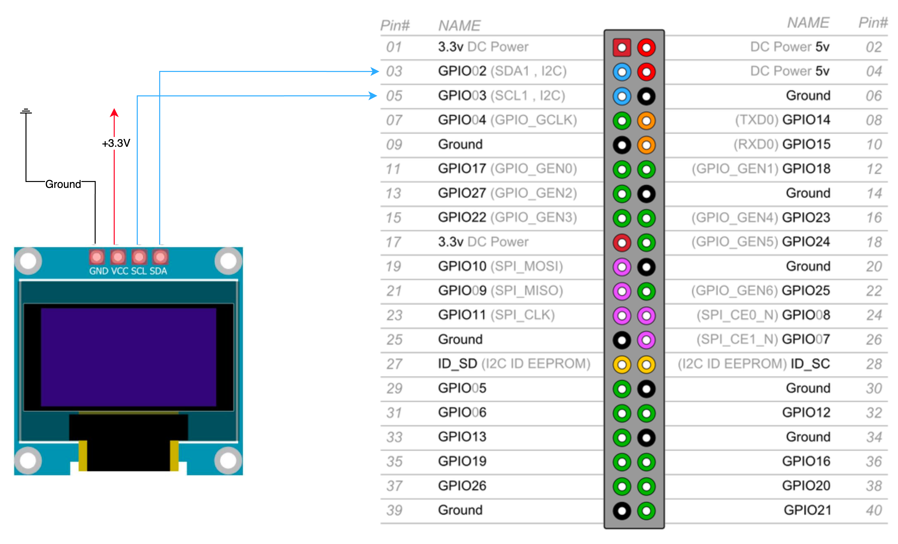
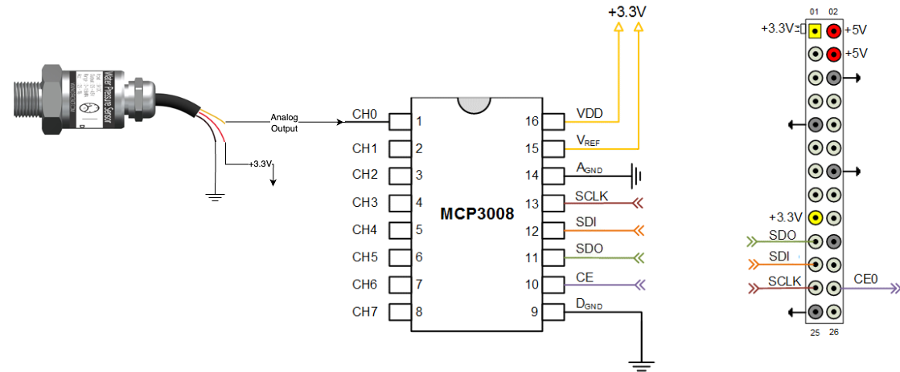

# Smart Espresso

[](https://www.python.org/downloads/)
[](LICENSE)
[](https://github.com/idoshr/smart-espresso)

_**WORK IN PROGRESS**_

DIY espresso machine monitoring with Raspberry Pi 4, pressure sensors,
OLED display, and optional Home Assistant integration.

## Features

- Real-time pressure monitoring (boiler & brew head)
- Water flow / shot-volume metering (hall-effect pulse sensor)
- Temperature & humidity monitoring (DHT22 / AM2302)
- Dual ADC support: MCP3008 (10-bit SPI) or ADS1115 (16-bit I2C)
- OLED display (SH1106 128x64)
- Machine state classification (off / heating / ready / brewing / steaming / over pressure)
- Shot history with head-pressure and flow curves, kept across reboots
- Water tank counter with refill reset, so you know before the 2 L tank runs dry
- Mobile web dashboard: manometers, machine state, tank level, shot history,
  and water used in the last 2 minutes
- Home Assistant integration
- Extensible sensor architecture

## Hardware

| Qty | Component | Link | Notes |
|-----|-----------|------|-------|
| 1 | Raspberry Pi 4 Model B (2GB+) | | Main controller |
| 1 | MCP3008 ADC **or** ADS1115 ADC | [MCP3008](https://a.aliexpress.com/_olcJc4g) / [ADS1115](https://a.aliexpress.com/_c3c7goPp) | ADS1115 default |
| 2 | Pressure Sensors (0-0.5MPa, 0-2MPa) | [AliExpress](https://a.aliexpress.com/_omToNFi) | ⚠️ Get 3.3V version (G1/8) |
| 1 | Mini Water Flow Sensor (DC3-24V, pulse output) | [AliExpress](https://a.aliexpress.com/_c4MPGp0X) | Optional — shot volume / flow rate |
| 1 | DHT22 / AM2302 Temp & Humidity Sensor | | Optional |
| 1 | SH1106 OLED Display (1.3", I2C) | [AliExpress](https://a.aliexpress.com/_oEzEfpA) | Optional |
| 2 | Brass Pipe Fittings (F-F-M 1/8") | [AliExpress](https://a.aliexpress.com/_okOIGjW) | For sensor mounting |
| 1 | Project Enclosure Box | [AliExpress](https://a.aliexpress.com/_c3qopgP1) | Houses the Raspberry Pi & electronics |

**Tools**: Soldering iron, multimeter, ratchet wrench, Teflon tape

> **Note on purchase links:** AliExpress listings expire over time. All links
> are kept in a single source of truth, [`docs/hardware.yml`](docs/hardware.yml),
> and checked automatically every week by the
> [Hardware Link Check](.github/workflows/link-check.yml) workflow. If a link
> above is dead, please update `docs/hardware.yml` and this table, or
> [open an issue](https://github.com/idoshr/smart-espresso/issues). Run the
> checker locally with `python scripts/check_links.py`.

## Wiring

### OLED Display (I2C)



| Pi Pin | → | Display |
|--------|---|---------|
| 1 (3.3V) | → | VCC |
| 3 (SDA) | → | SDA |
| 5 (SCL) | → | SCL |
| 6 (GND) | → | GND |

### MCP3008 (SPI)



| Pi Pin | → | MCP3008 |
|--------|---|---------|
| 1 (3.3V) | → | VDD (16), VREF (15) |
| 6 (GND) | → | AGND (14), DGND (9) |
| 19 (MOSI) | → | DIN (11) |
| 21 (MISO) | → | DOUT (12) |
| 23 (SCLK) | → | CLK (13) |
| 24 (CE0) | → | CS (10) |

Connect sensors: VCC→3.3V, GND→GND, OUT→CH0/CH1

### ADS1115 (I2C)

| Pi Pin | → | ADS1115 |
|--------|---|---------|
| 1 (3.3V) | → | VDD |
| 3 (SDA) | → | SDA |
| 5 (SCL) | → | SCL |
| 6 (GND) | → | GND |

Connect the sensors (VCC→3.3V, GND→GND, signal → analog input):
Head pressure → A0, Boiler pressure → A1, water flow (hall-effect pulse
output) → A2. See the usage example below.

> The water flow meter emits a pulse train; wiring its output to the ADS1115
> A2 channel lets the software recover the pulses by sampling the channel
> voltage. Sampling rate limits accuracy at very high flow, so for high-flow
> use a GPIO edge-interrupt wiring is more precise — but ADC sampling is
> sufficient for espresso shot metering.

## Installation

On a Raspberry Pi, install the hardware extras. The `dht` extra is separate
because `Adafruit_DHT` builds only on a Pi. A machine that only serves the
dashboard can install the core package, with no GPIO or ADC libraries.

```bash
# Enable interfaces
sudo raspi-config  # Enable I2C and/or SPI

# Install package with the Pi and DHT drivers
pip3 install "smart-espresso[pi,dht]"

# Or from source
git clone https://github.com/idoshr/smart-espresso.git
cd smart-espresso
pip3 install -e ".[pi,dht]"

# Same pins, including DHT: pip3 install -r requirements.txt

# Web stack only
pip3 install smart-espresso
```

## Running on boot

`deploy/smart-espresso.service` restarts the monitor if it ever exits.
Copy it to `/etc/systemd/system/`, point `ExecStart` and `WorkingDirectory`
at this checkout, and put secrets such as `HA_TOKEN` in
`/etc/smart-espresso.env` (mode `0600`). Then:

```bash
sudo systemctl enable --now smart-espresso.service
```

## Configuration

Set via environment variables:

```bash
export ADC_TYPE="ADS1115"          # or "MCP3008"
export HA_ENABLE="True"            # Optional
export HA_URL="http://192.168.1.100:8123"
export HA_TOKEN="your_token_here"

export WEB_ENABLE="True"           # Web dashboard, on by default
export WEB_HOST="0.0.0.0"          # 0.0.0.0 exposes it on the LAN
export WEB_PORT="8080"

export WATER_TANK_ML="2000"        # Tank size, default 2 L
export WATER_TANK_STATE="~/.smart_espresso/water_tank.json"

export SHOT_HISTORY_STATE="~/.smart_espresso/shot_history.json"
export SHOT_HISTORY_MAX="200"      # Completed shots kept on disk

export DHT_ENABLE="True"          # Ambient DHT22/AM2302 sensor (GPIO)
export DHT_PIN="4"                # BCM pin number for the DHT22

export FLOW_SAMPLE_INTERVAL="0.005"  # Flow pulse sampling period, seconds
```

The flow sensor's pulse polarity is detected automatically: sensors that
idle low (pulses rise) and open-collector sensors that idle high (pulses
drop) are both counted. The default `FLOW_SAMPLE_INTERVAL` is 5 ms
(200 Hz) on a background thread. Do not wrap that channel in a median
filter: a 3-sample median deletes pulses that are only one sample wide,
and the shot volume under-reads. The render loop's 10 Hz alone would
undersample an espresso shot. `/api/status` reports the measured
`sample_hz`.

Home Assistant publishes run on a background thread with a 2 s connect
timeout and a 3 s read timeout. A slow or unreachable server backs off
and cannot freeze the shot timer, the display, or the state classifier.
The published entities are each live sensor, the machine state, the shot
timer and the water tank.

### Generating Home Assistant API Token

To integrate with Home Assistant, you need a long-lived access token:

1. Open your Home Assistant web interface
2. Click on your profile (bottom left corner)
3. Scroll down to "Long-Lived Access Tokens" section
4. Click "Create Token"
5. Give it a descriptive name (e.g., "Smart Espresso")
6. Copy the generated token and use it as `HA_TOKEN`

**Important**: Save the token immediately. It is not shown again.
See the [authentication docs][ha-auth].

## Usage

See [main.py](main.py) for complete example.

```python
from smart_espresso.analog_sensor.ads1115_analog_sensor import ADS1115ADC
from smart_espresso.analog_sensor.pressure_analog_sensor import PressureAnalogSensor
from smart_espresso.analog_sensor.water_flow_sensor import WaterFlowAnalogSensor
from smart_espresso.smart_espresso import SmartEspresso
from smart_espresso.web.status_server import StatusServer

# Create sensors. The water flow meter's pulse output is wired to the
# ADS1115 A2 channel; the sensor counts pulses by sampling that channel.
analog_devices = [
    PressureAnalogSensor(adc=ADS1115ADC(pin=0, gain=2/3), name="Head", max_pressure_mpa=2.0),
    PressureAnalogSensor(adc=ADS1115ADC(pin=1, gain=2/3), name="Boiler", max_pressure_mpa=0.5),
    WaterFlowAnalogSensor(
        adc=ADS1115ADC(pin=2, gain=1),
        name="Brew",
        pulses_per_liter=5880,
        sample_interval=0.005,
    ),
]

# Run, serving the mobile dashboard on http://<pi-ip>:8080
se = SmartEspresso(
    analog_devices=analog_devices,
    client_ha=None,
    display=None,
    web_server=StatusServer(port=8080),
)
se.run()
```

**With MCP3008**: Replace `ADS1115ADC(pin=0, gain=2/3)` with
`MCP3008ADC(pin=0)`. Keep the `max_pressure_mpa` parameter.

## Web Dashboard

A small mobile-first status page runs alongside the render loop. Open
`http://<raspberry-pi-ip>:8080` from your phone (add it to the home screen for
a full-screen view).

It shows:

- **Machine state** (see below) as a full-width block you can read from
  across the kitchen: a 44 px label on a solid colour, with one secondary
  line (how long it has been ready, or boiler pressure against 0.8 bar
  while it warms, plus a thin progress bar). While a shot is pulled, a
  live timer shows yield and ratio; if you scroll away, a compact timer
  pins to the top edge. Entering the 25–30 s window buzzes once and
  flashes the card (the flash is skipped when the system asks for less
  motion). Holding **awake** — or long-pressing the state card — switches
  to glance mode: only that state and, during a shot, the timer.
- **Today's pulls** in the header, so a glance answers how many shots the
  machine has seen today (in memory; resets when the machine restarts)
- **Head pressure** and **Boiler pressure** on manometer dials, in bar,
  scaled to the working range with the target band marked and an
  over-pressure zone in red
- **Recent pulls** as a strip. A filled dot is on target, an open left
  chevron is fast, and a filled right chevron is long — the legend under
  the strip uses the same shapes. A tap selects the nearest pull, even
  when the marks sit on top of each other
- **Shot history**: the pulls saved on the Pi, each with the time of day,
  the duration, the volume, and the verdict in words (fast, on target,
  long). Tap one to chart its head pressure and flow (and the boiler,
  when that sensor is fitted)
- **Water tank level**: how much of the 2 L tank is left, roughly how many
  shots that is, and a _Tank filled_ button to reset the count after a refill
- **Water used in the last 2 minutes**, in millilitres, with a per-3-second
  bar chart and the live flow rate in ml/s
- Any other sensor (e.g. DHT22) as a plain row

The page is styled as a quiet pastel bar readout on a near-white ground:
crema for the group, a matcha green for the boiler, pale blue for water,
with a dark scheme that follows the system setting. Text clears
4.5:1 and the small marks (dots, ticks, graph lines) clear 3:1 on
both schemes. Labels are at least 11 px, and anything carrying a
number is at least 12 px. A stronger theme follows
`prefers-contrast: more`. The dial's over-band stays hidden until
the reading nears that band, so a resting head at 0 bar does not
look like a warning. Before the first
`/api/status` response the header and the state card read
**connecting…** (no green lamp), skeleton placeholders stand in for the
dials and the flow and tank cards, and the footer says **never
connected**. No number is shown until a payload arrives.

If three polls in a row fail, a banner says the machine can't be
reached, how old the last reading is, and offers **Retry now**. Retry
polls immediately and starts the backoff over; it does not pretend the
outage is over. Readings already on screen stay at full contrast with a
**stale** tag, and the shot timer does not keep counting. **Tank
filled** cannot reset the count while the machine is unreachable, and a
failed reset explains why in a toast. To add your own badge,
drop `logo.svg` into `smart_espresso/web/static/` and put an
`` in the header of
[`index.html`](smart_espresso/web/static/index.html).

### Machine State

[`machine_state.py`](smart_espresso/machine_state.py) classifies the machine
from the live readings, in this priority order:

| State | Condition | Meaning |
|-------|-----------|---------|
| `brewing` | Flow ≥ 0.3 ml/s, head ≥ 4.5 bar, or head ≥ 2 bar within 5 s of flow | "Pulling shot" |
| `steaming` | Boiler falling faster than 0.02 bar/s | "Steaming milk" |
| `off` | Boiler < 0.15 bar | "Resting" — machine is not heating |
| `heating` | Boiler < 0.8 bar | "Warming up" |
| `overpressure` | Boiler > 1.6 bar | "Pressure high" — check the pressurestat |
| `ready` | Boiler in the 0.8–1.6 bar band | "Ready to pull" |

A state must hold for 0.8 s before it is published, so one noisy ADC sample
cannot make the dashboard flicker; `brewing` is the exception and is published
immediately, so the shot timer starts on time. Every threshold is a constructor
argument on `MachineStateClassifier` if your machine runs different pressures.

While brewing, the classifier times the shot and measures its volume. Water
moving, pump-level head pressure, or brew-band pressure within 5 s of flow
publishes "Pulling shot" immediately. A saved shot also needs at least 2 s
of flow, 5 ml, and a head peak at the brew threshold (2 bar). A flush or
rinse with no brew pressure, and a backflush that barely moves water, update
the tank and are not shots. A pause that stays above 0.5 bar is the same
shot when flow returns within 10 s. Once the head vents, the next pull is a
new shot. The dashboard marks the 25–30 s window on the shot timer, so you
can see a pull running fast or long while it happens. Saved rows keep that
verdict in words, not only in colour. That same pull is appended to the shot
history below.

### Shot history

[`shot_history.py`](smart_espresso/shot_history.py) keeps every completed
pull, not just the last one. A pull is saved when it flowed for at least
2 s, reached 5 ml, and head pressure peaked at the brew threshold. A flush,
rinse, or backflush is left out. Each record stores:

- when the pull started (`started_at`, local time with its UTC offset)
- how long water was flowing (`seconds`, the same number as the live timer)
- the volume in millilitres
- headline peaks for head pressure, boiler pressure and flow
- the curves, sampled about four times a second: head pressure, boiler
  pressure when that sensor is fitted, and flow rate

`samples[].t` is elapsed time from the start of the pull, pauses included,
so the chart shows the pressure profile as it happened. The duration above
the chart does not count those pauses. Peaks are taken from every reading,
including ones that fell between two stored points.

The log is written to `SHOT_HISTORY_STATE` (default
`~/.smart_espresso/shot_history.json`) once per completed pull. The write
runs off the render thread. The temp file and its directory are fsynced,
and the previous good file is kept as `shot_history.json.bak`.
`SHOT_HISTORY_MAX` (default 200) caps the file; the oldest shots fall off.
An idle machine does not rewrite it. A missing file starts an empty log.
An unreadable file is renamed to `shot_history.json.corrupt-<time>` and is
not overwritten; the `.bak` is loaded when one is there.

`GET /api/status` includes a small `shots` block (`count`, and `recent`
newest first, without curves) so the dashboard list updates on the poll it
already does. `GET /api/shots` is that list on its own; `?limit=20` returns
the newest 20 summaries and `count` is still the whole log.
`GET /api/shots/<id>` returns one shot with its curves. That object is what
a later shareable shot card would be drawn from — start, duration, volume,
peaks and curves. This change charts the shot; it does not render the card.
An unknown id answers `404`.

```json
{
  "id": 42,
  "started_at": "2026-10-25T08:56:12-04:00",
  "seconds": 27.0,
  "ml": 36.4,
  "peak_head_bar": 9.1,
  "peak_boiler_bar": 1.2,
  "peak_flow_mls": 1.8,
  "samples": [
    {"t": 0.0, "head_bar": 2.1, "boiler_bar": 1.2, "flow_mls": 0.4},
    {"t": 0.25, "head_bar": 9.1, "boiler_bar": 1.2, "flow_mls": 1.8}
  ]
}
```

### Water Tank

[`water_tank.py`](smart_espresso/water_tank.py) subtracts the flow sensor's
lifetime volume from a baseline, so _used_ is the water drawn since the tank
was last filled. Pressing **Tank filled** (a two-tap confirm, so a stray tap
cannot wipe the count) calls `POST /api/tank/reset`, which moves the baseline
to the current total.

The count is written to `WATER_TANK_STATE` (atomically and fsynced, at most
every 15 s to spare the SD card) and restored on boot — otherwise every
restart would claim a full tank. A bad file is kept as
`water_tank.json.corrupt-<time>` and the last good `.bak` is used when one
exists. The dashboard warns below 15% remaining.

The page polls `GET /api/status` once per second:

```json
{
  "pressure": [{"name": "Head", "bar": 9.1, "max_bar": 20.0}],
  "flow": [{"name": "Brew", "recent_ml": 36.0, "total_ml": 128.4,
            "flow_rate_mls": 1.8, "sample_hz": 200.0,
            "window_seconds": 120.0, "chart": [0.0, 1.2]}],
  "machine": {"state": "brewing", "label": "Pulling shot", "severity": "active",
              "since_seconds": 12.4, "shot": {"seconds": 12.4, "ml": 22.1},
              "last_shot": {"seconds": 27.0, "ml": 38.4},
              "today": {"shots": 5, "ml": 183.4}},
  "shots": {"count": 42, "recent": [
    {"id": 42, "started_at": "2026-10-25T08:56:12-04:00",
     "seconds": 27.0, "ml": 36.4, "peak_head_bar": 9.1,
     "peak_flow_mls": 1.8}]},
  "tank": {"capacity_ml": 2000.0, "used_ml": 420.0, "remaining_ml": 1580.0,
           "percent": 79.0, "low": false, "empty": false, "shots_left": 43,
           "refills": 3},
  "other": [],
  "uptime": 412.3
}
```

`POST /api/tank/reset` marks the tank as refilled and returns the new tank
block. It requires the header `X-Espresso-Dashboard: 1`, which the dashboard
sends: a page on some other site that your phone happens to have open cannot
set a custom header without a CORS preflight this server never grants, so it
cannot zero your tank count behind your back.

Each pressure, flow and other entry also carries `health` (`ok`,
`last_error`, `last_ok_age_s`). A failed read is `ok: false` and its
value is null, so a stale sample is not shown as a live one.

The HTTP handlers only read an in-memory snapshot taken by the render loop, so
opening the page never triggers extra I2C/SPI traffic. The recent-water figure
comes from a rolling history of cumulative volume kept by the server, so the
flow sensor itself stays a simple pulse counter.

Disable it with `WEB_ENABLE=False`. The server binds to all interfaces by
default and has no authentication — keep it on a trusted home network, or set
`WEB_HOST=127.0.0.1` and reach it through a reverse proxy or SSH tunnel.

## Troubleshooting

- **No devices**: `sudo raspi-config` → Enable I2C/SPI, then `sudo i2cdetect -y 1`
- **Wrong readings**: Verify 3.3V sensors, check wiring, wait for auto-calibration
- **Display issues**: Check I2C address with `sudo i2cdetect -y 1` (usually 0x3C)
- **HA errors**: Verify URL includes `http://`, check token validity
- **Dashboard unreachable**: Check the Pi's IP (`hostname -I`), confirm
  port 8080 is not firewalled, and that `WEB_ENABLE` is not `False`
- **State stuck on `heating` or `overpressure`**: The boiler is outside
  the default 0.8-1.6 bar band. Pass `ready_min_bar` and `ready_max_bar`
  to `MachineStateClassifier`
- **Tank count looks wrong**: It counts measured water only. Delete
  `WATER_TANK_STATE` to start over, and press _Tank filled_ at every refill
- **Shot history looks wrong**: A saved shot flowed for at least 2 s, reached
  5 ml, and peaked at 2 bar. Delete `SHOT_HISTORY_STATE` to start the log over
- **Permissions**: `sudo usermod -a -G spi,i2c,gpio pi && sudo reboot`

## Project Structure

```text
smart_espresso/
├── analog_sensor/
│   ├── analog_sensor.py           # Base classes (ADCInterface, AnalogSensor)
│   ├── mcp3008_analog_sensor.py   # MCP3008 ADC
│   ├── ads1115_analog_sensor.py   # ADS1115 ADC
│   ├── pressure_analog_sensor.py  # Pressure sensor
│   ├── water_flow_sensor.py       # Water flow meter (pulse) sensor
│   └── dht22_sensor.py            # DHT22 temp/humidity sensor
├── machine_state.py               # Machine state classifier + shot timer
├── shot_history.py                # Persisted shot log and curves
├── water_tank.py                  # Tank counter (persisted across reboots)
├── web/
│   ├── status_server.py           # Flask status API + dashboard server
│   └── static/index.html          # Mobile dashboard page
├── test/                          # Unit tests
├── smart_espresso.py              # Main class
└── utils.py                       # Helpers
```

## Contributing

Pull requests welcome! Run tests with `pytest smart_espresso/test/`

## License

BSD 3-Clause License

## References

- [DFRobot Pressure Sensor](https://wiki.dfrobot.com/Gravity__Water_Pressure_Sensor_SKU__SEN0257)
- [Coffee4Randy's Project](https://sites.google.com/view/coffee4randy/home)
- [Raspberry Pi Pinout](https://pinout.xyz)

---

Made with ☕ by coffee enthusiasts

[ha-auth]: https://developers.home-assistant.io/docs/auth_api/#long-lived-access-token
